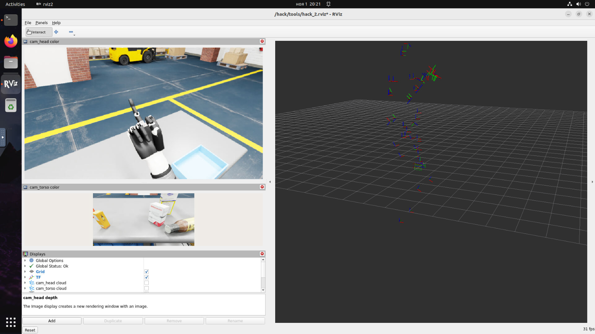

# ros2 среда для хакатона ROS Humanoid hack подключенная к репозиторию организаторов

Только разбираемся с репозиторием

## Свои пакеты

- [`focus_tracking/`](focus_tracking) — фокусировка головы на объектах / руках / обоих сразу (HSV+depth детектор, TF2 hand-tracker, контроллер c deadzone/LPF). Математика и архитектура: [docs/FOCUS_TRACKING.md](docs/FOCUS_TRACKING.md). (нестабильно)

- [`arm_ik/`](arm_ik) — URDF-driven IK обеих 7-DOF рук (ROS 2 Humble); пакет содержит офлайн-тесты; успешная сборка в Humble и проверка на роботе ещё не подтверждены.
